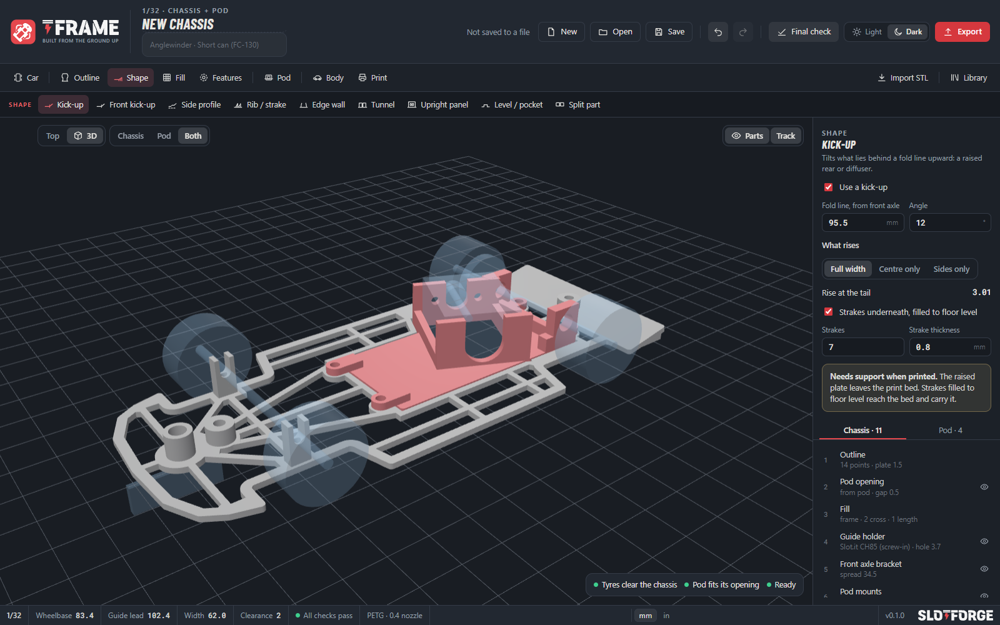
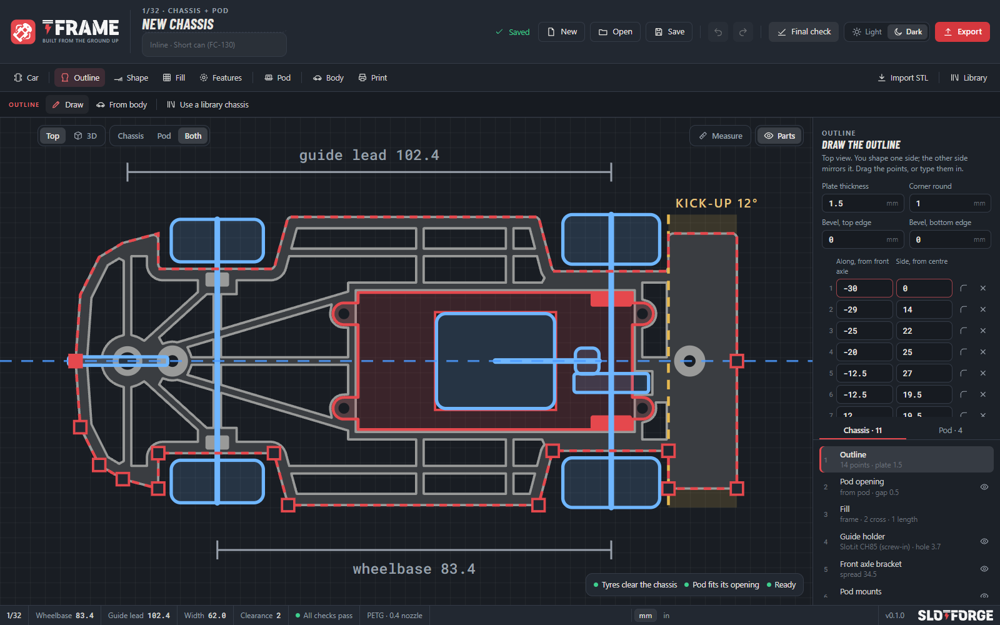
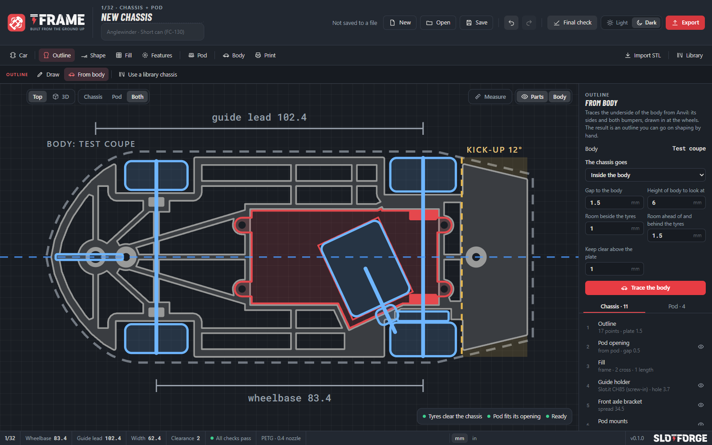
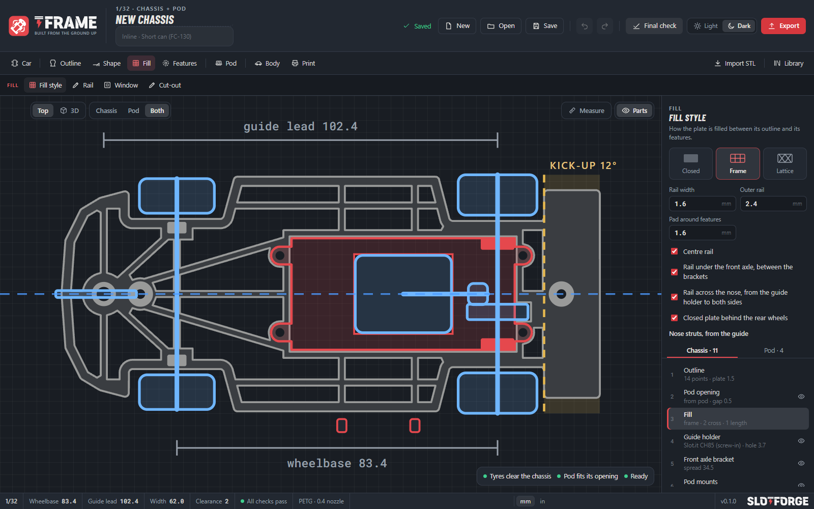
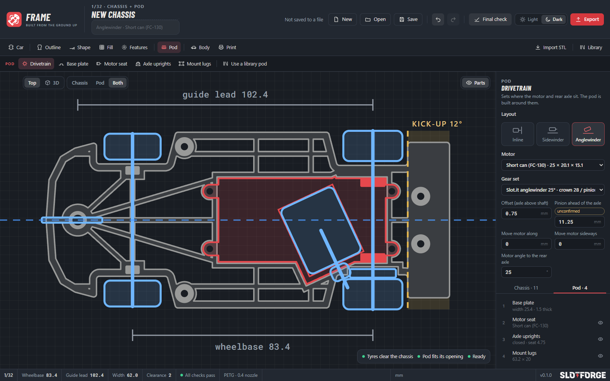
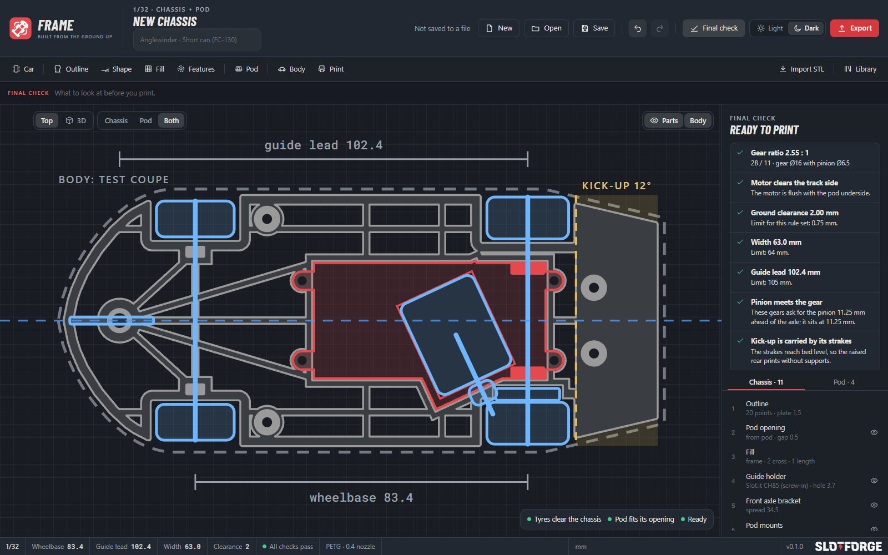
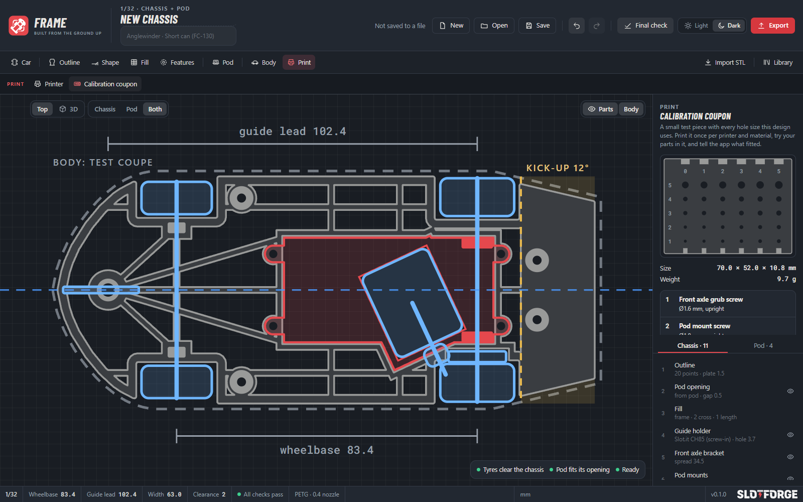
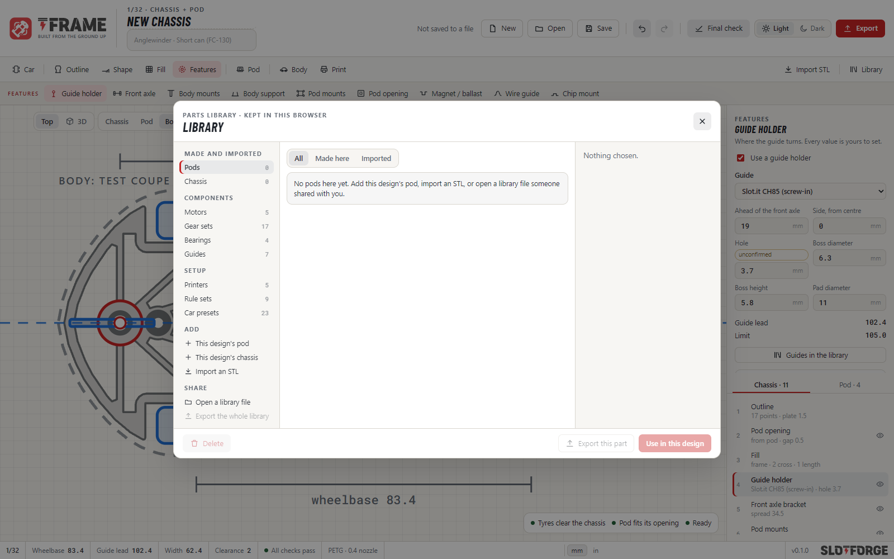
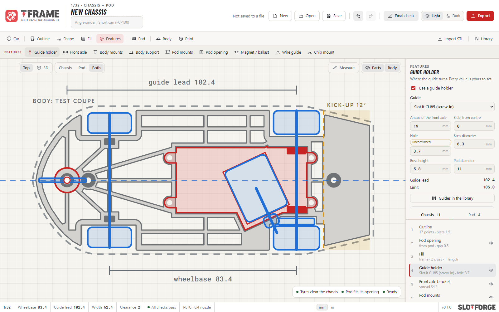

  
  

 

# SlotForge Frame

**Built from the ground up: a printable chassis and motor pod for your slotcar.**

SlotForge Frame designs a 3D-printable slotcar chassis around the parts you race with: your wheels, guide, motor, gears and bearings. Draw the outline, or trace it from the body. Choose a closed plate or a light rail frame, shape a raised rear with strakes, and place the guide holder, the front axle brackets, the body mounts, magnets and wire guides wherever you want them.

The motor pod is designed with it, for inline, sidewinder and anglewinder motors, with bearing holders that are sized for your printer. A live preview shows the axles, wheels, motor and gears in place, and a final check goes through what matters before you print.

**A desktop app for Windows, macOS and Linux. Your designs stay on your computer. No account required.**

[Download Frame](https://github.com/theDutchmanJames/SlotForgeFrame/releases/latest) · [See the app](#pictures-of-the-app) · [Explore the features](#features-and-functionality) · [How to install](#how-to-install) · [Report a problem](#reporting-problems)

## SlotForge App Collection

SlotForge Frame is part of the **SlotForge App Collection**—apps for building tracks, managing your cars, designing their appearance and exploring their performance.

-  **[SlotForge Foundry](https://github.com/theDutchmanJames/SlotForgeFoundry)** — Turn slotcar track into printable parts, plan a layout and edit any STL.
-  **[SlotForge Anvil](https://github.com/theDutchmanJames/SlotForgeAnvil)** — Turn any car model into a light, printable slotcar body.
-  **[SlotForge Circuit](https://github.com/theDutchmanJames/SlotForgeCircuit)** — Design slotcar tracks, including routed and FreeForm layouts, and export track data for Timing's Live Tracker.
-  **[SlotForge Timing](https://github.com/theDutchmanJames/SlotForgeTiming)** — Lap timing, race management and custom race displays for analogue slot-car tracks.
-  **[SlotForge Paddock](https://github.com/theDutchmanJames/SlotForgePaddock)** — Organize your slotcar collection, photographs, parts, setups and maintenance in a virtual garage and workshop.
-  **[SlotForge Telemetry](https://github.com/theDutchmanJames/SlotForgeTelemetry)** — Explore gearing, motors, tyres and weight, compare setups, and analyse recorded lap times.
-  **[SlotForge Decals](https://github.com/theDutchmanJames/SlotForgeDecals)** — Size and arrange artwork into decal sheets, then export a PDF for printing.
-  **[SlotForge Livery](https://github.com/theDutchmanJames/SlotForgeLivery)** — Plan paint schemes, stripes, race numbers and decals on editable 2D car templates.

Visit each app's repository for its features, downloads and getting-started guide.

## Pictures of the app

**The chassis and its pod in 3D** — a 1/32 rail-frame chassis with a raised rear and an anglewinder pod, with the wheels, axles, motor and gears shown in place.

| Draw the outline | From body | Rail frame |
| :---: | :---: | :---: |
|  |  |  |
| You shape one side; the other side mirrors it. | Trace the body from Anvil: sides, bumpers and wheel arches. | A closed plate, a rail frame or a lattice. |

| Drivetrain | Final check | Calibration coupon |
| :---: | :---: | :---: |
|  |  |  |
| Inline, sidewinder or anglewinder, at the angle you set. | Everything that matters before printing. | Print it once to make every hole fit. |

| Library | Light theme |
| :---: | :---: |
|  |  |
| Your chassis, pods and components, shareable as a file. | Light or Dark, shared with the other SlotForge apps. |

Click any picture to open it at full size.

## Features and functionality

Frame works along eight menus, roughly in the order you build a car: **Car, Outline, Shape, Fill, Features, Pod, Body and Print**. Every part of the design is a feature in the list on the right, with its own numbers: where it sits and how large it is are always yours to set. Undo and redo work as you expect.

### Start from your car

- **1/32 and 1/24:** start a new chassis in either scale, with matching starting values.
- **Wheels and axles:** wheelbase, ground clearance, axle diameter, and tyre diameter, width and track for the front and the rear.
- **Rules:** the widest car, the longest guide lead and the least clearance your club allows. The final check compares the design with them.
- **Car presets and rule sets** come from the library, and you can add your own. A car preset sets the wheelbase, and the tyres and the track where its maker publishes them (Policar, BRM, Carrera Digital 124 and more); length, width and weight are there to compare with.

### Draw the outline

- **Draw:** shape one side as points in the top view; the other side mirrors it. Drag the points or type them in. Mark a point as curved and the outline bends past it; round the corners and bevel the top or bottom edge.
- **From body:** load the body you made in SlotForge Anvil and trace it. The chassis goes inside the body, a gap from its walls, sills and bumpers, or under it, with the body standing on the plate and the plate reaching out by an amount you set. The trace follows the body's lower edge, not a bumper or exhaust that sticks out, and leaves the wheel arches open. The result is an outline you go on shaping by hand.
- **Plate thickness** and every other size in millimetres.

### Shape it

- **Kick-up:** tilt the rear upward behind a fold line, over the full width, only the centre or only the sides, with strakes underneath like a diffuser. A front kick-up does the same at the nose.
- **Side profile:** let the plate follow a height line along the car, for a stepped or rising floor.
- **Ribs and strakes, edge walls, tunnels, upright panels, levels and pockets:** stiffen the plate and shape it, each placed and sized freely and mirrored if you want. Ribs and walls can have a rounded root where they meet the plate.
- **Split part:** print a long chassis as two parts that key into each other.

### Fill: closed, rail frame or lattice

- **Closed:** a full plate.
- **Rail frame:** an outer rail with cross rails and lengthwise rails, pads under every feature, a spine, struts in the nose, a rail under the front axle and a closed plate behind the rear wheels. Frame proposes where the cross rails go; move, add or remove them. The chassis always runs all the way round the motor pod.
- **Lattice:** an open mesh with the cell size you set.
- **Rails, windows and cut-outs:** draw extra rails of your own, cut windows out of a closed plate, or cut any closed shape through the plate or sink it in.

### Guide, front axle and mounts

- **Guide holder:** for the common guides, or your own sizes, anywhere ahead of the front axle.
- **Front axle brackets:** their spread, height and wall, with an axle slot that fits your printer. Give the axle travel up and down, grub screws from below and above, or a stub axle for each wheel.
- **Body mounts and supports:** as many mount spots as you need, shared with SlotForge Anvil, and tabs that reach out from the edge of the plate for the body to rest on.
- **Magnet and ballast holders, wire guides and a chip mount:** walled pockets for magnets or weights, posts that hold the lead wires, and a tray for a digital chip, each where you put it.
- **Pod mounts and pod opening:** the default four-screw pattern is 63.2 × 20 mm; change it, or let it follow an imported pod.

### The motor pod

- **Inline, sidewinder and anglewinder,** for short-can, long-can and slim-can motors, driving the right or the left rear wheel. The anglewinder's angle to the rear axle is yours to set, and the app says when it differs from what the gears are cut for. A motor that drives from its endbell can be turned end for end.
- **Gears:** pick a crown or spur gear set; the motor is placed so that the gears mesh. A gear set says how its gear is built (disc, boss and which way it points), and the chassis is cut free for it.
- **In its opening or on top:** the pod drops into its opening, or sits on top of the chassis rails as on the makers' chassis, with the motor and axle dropped through its floor. Move it sideways, and give it float on its screws.
- **Bearing holders:** closed, snap-in or clamp, with a buttress on the motor side, a brace between them and room to oil the bearing.
- **Motor seat, base plate and mount lugs,** each with its own sizes.
- **Live preview:** axles, wheels, tyres, motor, pinion and gear are drawn in place in the top view and in 3D.

### Wheel inserts

- **Inserts for aluminium wheels:** a disc, or a cup with a skirt, that presses into the pocket in the face of an insert wheel. Set the wheel's diameter and its pocket, and the insert's size follows, with a fit clearance you choose.
- **Patterns from layers:** spokes (straight, bent, split, or crossed into a mesh), holes (round, slot or window), rings, bolts with a hex or centre-lock nut, and shapes you draw yourself or import as SVG. Each layer repeats round the centre by itself and is cut through, sunk into the face or raised from it. The face sits flush with the outer ring, or as deep below it as you set, with a dish and a centre hole if you want them.
- **Start from a pattern:** 5-spoke, split 10, mesh, 8-hole, turbine, slots, windows and dish, all of them only layers you can change.
- **Ready-made designs by Jivko:** ten inserts (Abstract, Aero One, Aero Two, B29, Eight, Retro 4, Sci-Fi, Six, Sport Star and Star), built into the app and the library as "Jivko Design - …". Set the diameter (or let the pocket and the clearance set it), the depth and an axle hole. The diameter scales the design across only, so the face keeps its height and detail as drawn; the depth makes the plain back behind it deeper or shallower, never less than the face needs. Frame checks that the axle hole stays inside the solid hub. Designed by Jivko and included with the designer's permission.
- **Front and rear:** the same insert all round, or one of each. The set of four prints on one plate, face up or face down (a cup always face down, so that its face is not printed in the air; Frame checks that the face is flat); a pattern that bends one way is mirrored for the other side of the car.
- **Fit and checks:** a calibration ring of seven numbered discs, round a middle size you set and a step you choose, finds the size that presses in firmly. Frame warns about spokes thinner than the nozzle, holes that run into each other, a pattern that cuts the insert into loose pieces, and an insert that stands out of its pocket.

### Rear wings

- **A wing for the body:** span, chord, an upside-down wing profile with its thickness and camber, the angle, a Gurney flap and an optional second element, as on the real cars. Give it a flat underside or a flat top, and it prints lying flat. Six to start from, for 1/32 or 1/24: GT3 swan neck, GT3 on posts, LMP, DTM with two elements, Group C and a classic flat wing.
- **Endplates:** GT3, square, rounded or a tall LMP shape, sized round the wing, or your own: start from one of them and drag its points, or import an SVG.
- **Legs and mounting:** swan necks from above or posts from below, one or two, as far apart and as tall as you set. Each leg ends in pins that go through the body: melted over from inside into a small head (with a collar that sets the height), or glued on a flat foot, with or without short pins to locate it. The body's wall and slope are taken into account.
- **Print:** in one piece, as a kit with the legs apart, or all apart with the endplates flat and pockets that the wing fits into (a wing with a flat side lies flat on it). A drilling template puts the holes in the body where the pins go.
- **Checks:** a wing, a trailing edge, legs, endplates or pins too thin to print, legs that miss the wing or stand outside it, endplates that reach into the body, and a wing wider than your rules allow. The weight is shown.

### Bought and shared parts

- **Rear axle seats:** a straight seat for a ball bearing or bushing, or a round snap-in socket for a spherical bushing (Slot.it CH14, Sloting Plus ball joints) that tilts with the axle. A flanged bearing or bushing gets its flange on the wheel or motor side, sunk into a recess or standing out of the face, or two flanges with the upright held between them; any bearing, your own included, can have one. Eccentric bushings, which turn to set the axle's height, get a mark on each upright, and a bearing without a flange can sit against a shoulder. The flanged ball bearings come at NSK's catalogue sizes. Or one axle tube through both uprights, such as a Sloting Plus Combi Plus, which sets how far apart they stand.
- **Import an STL** of a pod or a chassis you bought or downloaded. Frame measures it, finds its screw holes, and fits the chassis round an imported pod. An imported chassis can be made editable: its shape becomes your outline.
- **Library:** every chassis, pod, wheel insert and rear wing you make or import, kept in one file on your computer, with motors, gear sets, bearings, guides, printers, rule sets and car presets beside them. Add components of your own.
- **Share:** export a part, or the whole library, as a `.framelib` file for other SlotForge Frame users, and open theirs.

### Work with SlotForge Anvil

- **Export for Anvil:** an `.anvilchassis` file with the chassis, the pod and the body-mount spots. Anvil shows them inside the body and builds the posts on those spots.
- **Body from Anvil:** load the body's STL and turn it the right way up. It shows over the chassis as a ghost or solid. Frame finds its wheel arches and fits the wheelbase and the axles to them, says whether the chassis and the wheels stay inside it, and checks in 3D that nothing of the chassis runs into the body.

### Check, then print

- **Printer and material:** nozzle, minimum wall and the fixes for holes that print undersize.
- **Calibration coupon:** a small test piece with every hole size your design uses. Print it once per printer and material, try your parts in it, and tell the app which holes fitted.
- **Final check:** one list of what matters before printing (one solid piece, tyres clear of the chassis, the pod in its opening, gear mesh, wall thickness, your rules), each row leading to the tool that fixes it. Sizes that no maker publishes are marked **unconfirmed**, so you know what to measure.
- **Weight and balance:** the weight of the printed parts with the weights you add, and where the centre of gravity lies.
- **Millimetres or inches,** and a measuring tool in the top view.
- **Export STL:** the chassis and the pod, laid flat for printing, and split parts as their own files.
- **Projects:** your design is kept on this computer and opens again next time. **Save** writes a `.frame` file with everything in it, imported parts included.

### Make Frame look the way you want

**Light** and **Dark** themes, shared with the other SlotForge apps on the same computer.

## How to install

Open the **[latest release](https://github.com/theDutchmanJames/SlotForgeFrame/releases/latest)** and expand **Assets**. Choose the finished app for your computer. **Desktop downloads need no Node.js, coding or terminal commands.** GitHub's automatic Source code downloads are for building it yourself.

| Your computer | Choose this download |
| --- | --- |
| **Windows · Intel/AMD 64-bit** | **Portable-x64.exe** to try the app, or **Setup-x64.exe** to install it for regular use. The **Windows-x64.zip** is the same app to unzip anywhere. |
| **macOS · Apple Silicon and Intel** | **mac-universal.dmg**, or the **.zip** of the same app. |
| **Linux · Debian/Ubuntu-based** | **.deb** (amd64 or arm64), opened with your package installer. |
| **Linux · other distributions** | **.AppImage** (x86_64 or arm64), with permission to execute enabled. |

### Windows

Start **Portable-x64.exe** to try Frame without installing it. To install, run **Setup-x64.exe**; you can choose the folder, and it adds a desktop and Start menu shortcut.

Frame is not code-signed. If Windows SmartScreen appears, choose **More info → Run anyway**.

### macOS

Open the **.dmg** and drag **SlotForge Frame** to **Applications**. Frame is not notarised: the first time, macOS blocks it. Open **System Settings → Privacy & Security** and choose **Open Anyway**.

### Linux

**Debian/Ubuntu-based systems:** open the **.deb** with your software/package installer, choose **Install**, then start Frame from the applications menu.

**AppImage:** save the file, open **Properties → Permissions**, enable **Allow executing file as program** or your distribution's equivalent, then double-click it. AppImage support depends on your distribution and FUSE configuration; the DEB is an alternative on Debian-based systems.

### Run or build from source

See [Developing SlotForge Frame](docs/DEVELOPMENT.md) for running the app from the code, the tests and the builds.

### Your first chassis

1. Choose **New** and pick **1/32** or **1/24**.
2. Under **Car › Wheels and axles**, type the wheelbase and the tyre sizes of your car.
3. Under **Outline › Draw**, drag the points to shape one side. With a body from Anvil, use **Outline › From body** to trace it.
4. Under **Pod › Drivetrain**, choose the layout, the motor and the gears.
5. Under **Print › Printer**, choose your material. Print the **calibration coupon** once and set the two hole fixes.
6. Choose **Final check**, fix what it points out, then **Export**.

### Updating, backups and moving computers

Frame checks for a new release when it starts and shows what's new. Choose **Download** to save the new version in your Downloads folder, or **Skip this version**. Open **Settings** (the sliders button in the top bar) to **Check now** or switch off the check at start. Your designs, library and settings stay where they are when you update.

Frame keeps your last design, the library and its settings in its user-data folder. On Windows this is normally `%APPDATA%/SlotForge Frame/`, on macOS `~/Library/Application Support/SlotForge Frame`, and on Linux `~/.config/SlotForge Frame`. **Help → Show data folder** opens it; the library is the file `library.sqlite`.

To keep a design safe or move it to another computer, choose **Save**: the `.frame` file holds the whole design. Export the library as a `.framelib` file to take your parts and components along.

## Reporting problems

Open a [GitHub issue](https://github.com/theDutchmanJames/SlotForgeFrame/issues) and include:

- Your app version and operating system.
- What you expected, what happened, and the steps needed to reproduce it.
- A screenshot and the exact error message, if one appears.
- For design problems: the `.frame` file, if you are allowed to share the imported parts in it.
- For fit and print problems: your printer, material and nozzle, the two hole fixes you use, the part that did not fit and a photo of the print.

Use a small example where possible, and remove private information before sharing files.

## License and copyright

SlotForge Frame is made by theDutchmanJames. Copyright 2026 theDutchmanJames and contributors.

SlotForge Frame is provided under the **SlotForge Source-Available License 1.0 — No Software Sales or Paid Access**.

- Personal, educational, club and internal business use are permitted without charge.
- You may study, modify and share free copies, keeping the license and notices and identifying your modifications.
- Selling the app, including modified versions or copies bundled into paid offerings, or charging for access requires separate written permission.
- You may use or sell your own chassis designs, STL files and printed parts, subject to the rights in any parts you import. This does not permit selling the app itself.
- Voluntary donations are allowed when access and use do not depend on payment.

See [LICENSE](LICENSE) for the full terms. Third-party components retain their own licenses: see [THIRD-PARTY-NOTICES.txt](THIRD-PARTY-NOTICES.txt).

Imported chassis, pods and bodies belong to their makers. Only use and share parts you are allowed to; Frame does not include any maker's parts. The names of makers and their products are used only to say which bought parts a design fits.
